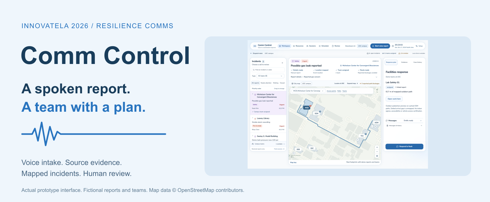
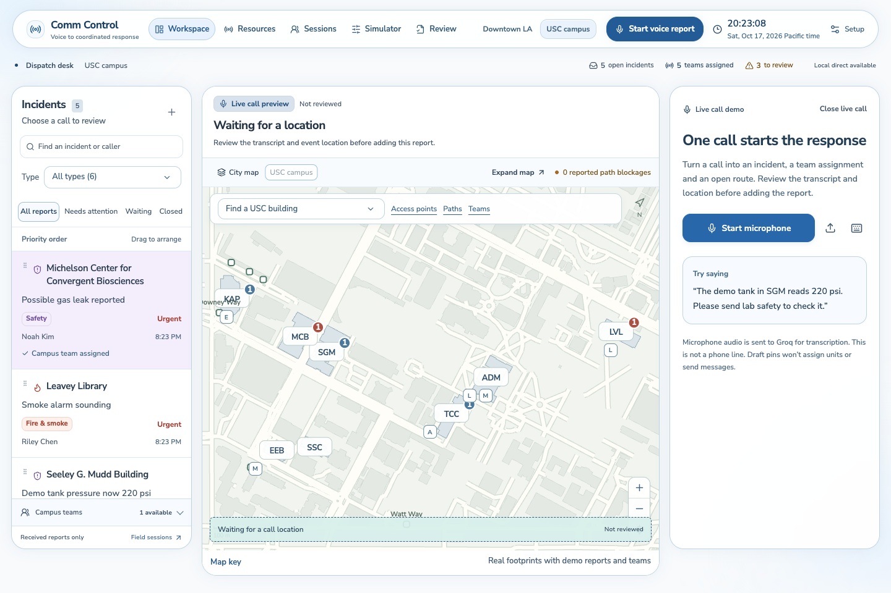
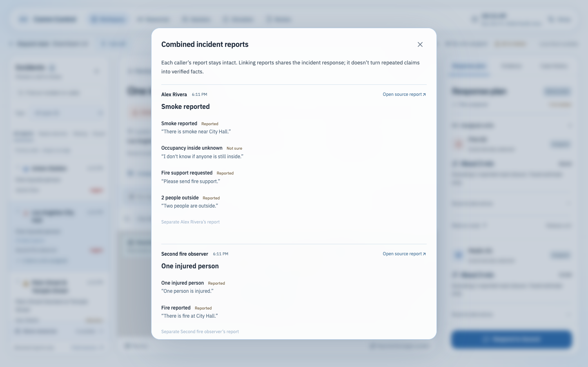
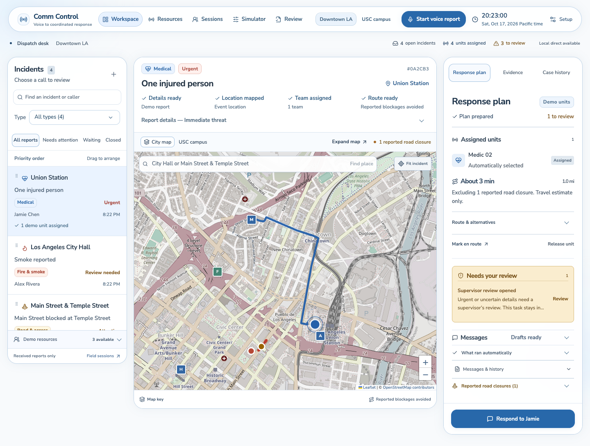
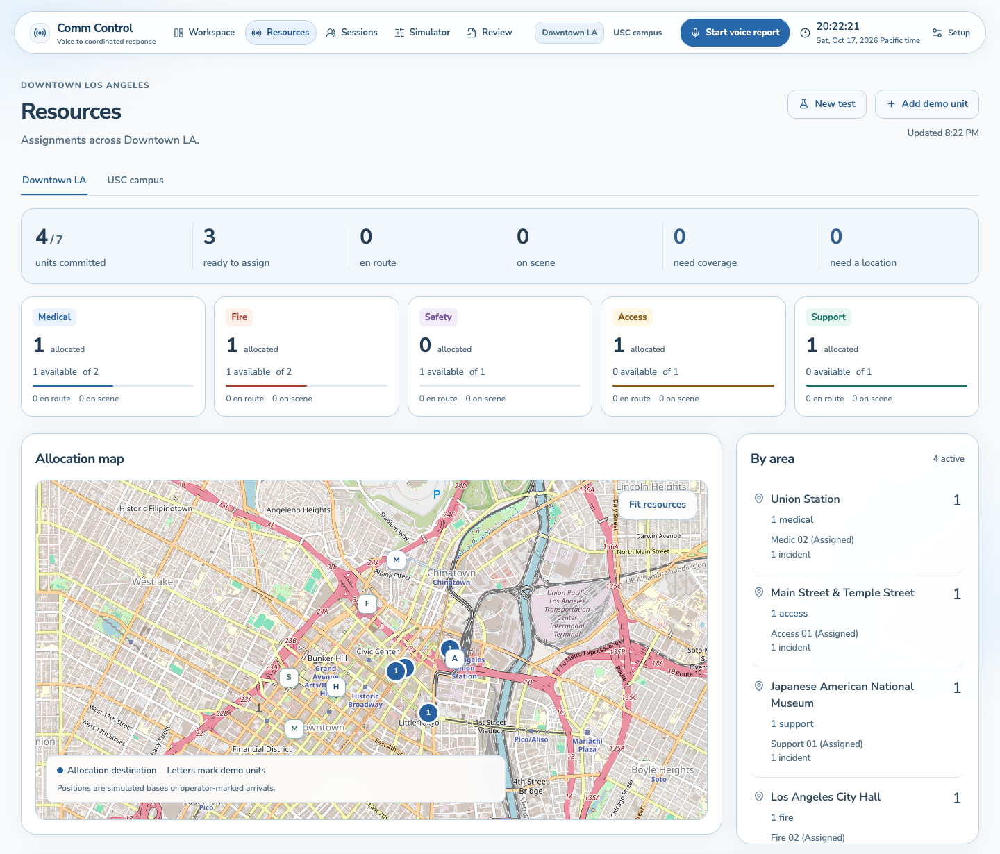
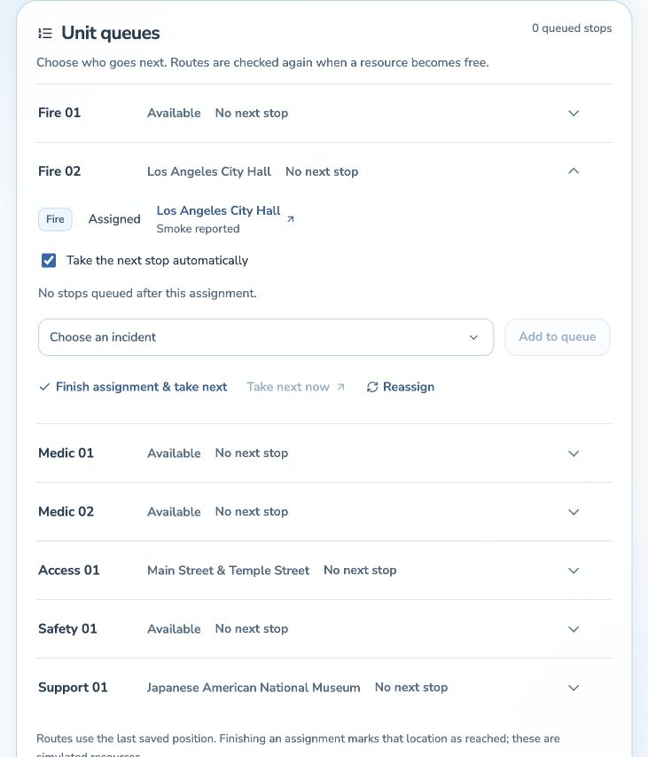
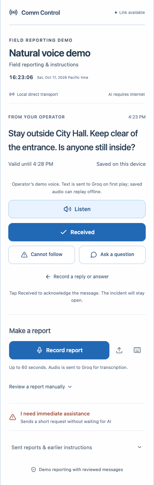
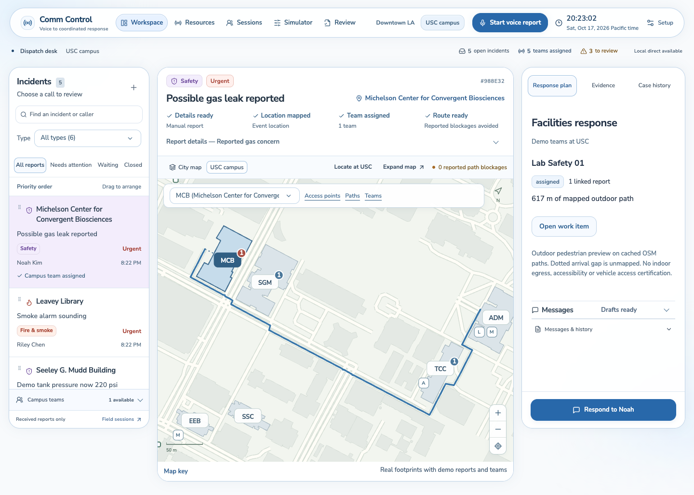
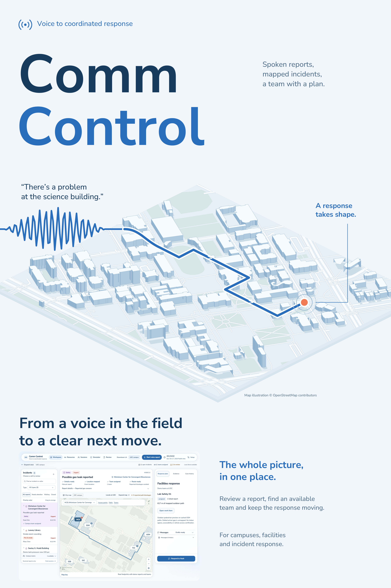

  

  <a href="https://several-monday-invite-cakes.trycloudflare.com/">Try the live demo</a> &nbsp;&nbsp;&nbsp;
  <a href="presentation/Comm_Control_Pitch.pptx">PowerPoint deck</a> &nbsp;&nbsp;&nbsp;
  <a href="presentation/Comm_Control_Pitch.pdf">PDF deck</a> &nbsp;&nbsp;&nbsp;
  <a href="presentation/Comm_Control_Poster.pdf">Download the poster</a>

# Comm Control

**From a spoken report to a coordinated response.**

Comm Control helps an operator turn a voice report into a mapped incident and a response plan. It keeps the caller's words attached to the facts, checks which demo teams can help, and finds routes around reported blockages. The operator can review uncertain details and approve outgoing instructions from the same workspace.

Built for the **Resilience Comms** lens at the **InnovateLA x Dual-Use Hackathon**, October 16–18, 2026, at USC.

## Start with the working demo

**[Open Comm Control →](https://several-monday-invite-cakes.trycloudflare.com/)**

The public demo opens a shared workspace with fictional reports and teams. It runs the real coordination backend. Hosted voice AI is disabled on this instance; the [local setup](docs/SETUP.md) enables the voice workflow with your own provider account. The public link is temporary and depends on the host laptop staying online. Use fictional information because visitors share the same demo data.

A quick way to explore:

1. Open the workspace and select **Union Station**. Follow the report through its location, assigned medic and route around the reported closure.
2. Select **City Hall**, then open **Evidence** to see the source and the uncertainty about who may still be inside.
3. Open **Resources** to inspect capabilities, assignments and next-stop queues. The **USC campus** workspace shows how the same system supports facilities work.

Download the pitch as a [PowerPoint](presentation/Comm_Control_Pitch.pptx) or [PDF](presentation/Comm_Control_Pitch.pdf).

## The person we're building for

A campus or facilities operator hears: “There's smoke near City Hall. Two people are outside. I don't know if anyone is still inside.”

That report leaves work to do. The operator needs to locate the event, understand what remains unknown, find a suitable team and check whether it can reach the scene. A confident summary alone doesn't answer those questions.

The hackathon prompt asks teams to help someone prepare for disaster and choose a proportionate response before a disruptive shutdown. Our person is the operator at the desk. Comm Control helps them ask for missing information, hold a plan that can't be supported and send a specific instruction once it's reviewed. Routine maintenance gives that workflow a reason to be in place before an emergency.

## Follow a report through the system

### Capture the report and check what it means

Record in the browser or upload a recording. Speech recognition produces a transcript, and structured extraction identifies observations, requests, uncertainty and mentioned places. The operator reviews those details before adding the incident to the received queue. A preview pin doesn't reserve a team or send an instruction.

*Actual intake interface. The local build supports hosted transcription and extraction; this screenshot shows the call before recording starts.*

### Keep the source beside the interpretation

Each extracted claim retains the words that support it. “I don't know if anyone is still inside” stays uncertain. Related reports can share a response while keeping each caller's account intact. Repeated claims don't become verified facts simply because they were combined.

### Locate the event and work out a response

Comm Control distinguishes the incident location from the reporter's position. It uses real map geometry for Downtown Los Angeles and USC. An unresolved location holds allocation for review.

For a located, received report, the planning engine checks a team's capability, availability and supported route. Reported closures affect later routes too. A blockage stays excluded until supported clearance or an operator decision reopens it; age alone doesn't make it safe.

### Keep work moving after the first assignment

Resources shows which capabilities are available, where demo units are assigned and which cases still need coverage. Persistent next-stop queues let an operator arrange work, pause automatic advancement, finish a stop or reassign it. A queued stop checks current closures again when its team becomes free.

See the next-stop queue controls

### Close the communication loop

The operator can prepare an instruction and approve its exact wording. The field view supports spoken playback, acknowledgment and replies. Sending a message, receiving it and getting a person's acknowledgment are separate events. An acknowledgment doesn't automatically resolve the incident.

*Fictional field report and instruction from the working prototype.*

## One workflow, two settings

| Ordinary day | During a disruption |
| --- | --- |
| A facilities desk receives a maintenance report, locates the building and assigns a suitable team. | An operator organizes incoming incident reports, preserves uncertainty and checks access before coordinating a response. |
| Resources and queues help keep routine work organized. | Shared closure information and current availability help avoid unsupported assignments. |
| Case history preserves handoffs and corrections. | Source evidence lets an operator revisit a claim as the situation changes. |

The campus workspace is our everyday-use demonstration. The Downtown LA workspace demonstrates incident coordination with fictional responders. Using the workflow routinely could help teams learn the maps, procedures and review habits before an emergency; testing that benefit is part of the proposed pilot.

*Real campus geography, fictional facilities reports and teams. Team positions are operator-marked or simulated, not live GPS.*

## How it works

| Part | What it does | Technology |
| --- | --- | --- |
| Operator and field views | Recording, review, maps, queues and replies | React, TypeScript, Vite, browser media APIs |
| Voice processing | Turns audio into text, then extracts facts tied to source excerpts | Groq-hosted Whisper and GPT-OSS; server-side integration |
| Coordination backend | Applies review rules and manages reports, resources and assignments | Python, FastAPI |
| Maps and routing | Resolves supported places and searches the bundled road/path graphs around reported closures | Leaflet, OpenStreetMap data, local routing logic |
| Persistence | Saves evidence, corrections, work queues and decision history | SQLite |
| Delivery experiment | Exercises compact packets, delayed delivery, retries and receipts | Software transport simulator |

The language model interprets the report. Local rules check the resulting claims and constrain the response plan. Database transactions and version checks protect changes when two actions compete for the same resource. We refined prompts and evidence guards; we didn't fine-tune model weights.

[Read the technical walkthrough](docs/TECHNICAL.md) for the main decisions and source-code map. Credentials and private runtime data are excluded from this repository.

## What the prototype demonstrates

The project verification record reports **241 backend tests** and **45 distinct browser checks** passed. Coverage includes source retention, uncertain locations, closure-aware routing, assignment queues, failed reassignment recovery and separate City/USC state. Four hosted speech/model checks were skipped in that release. These are software checks, not measurements of emergency-response outcomes or model accuracy.

The local build has connected voice-processing evidence using fictional speech. The public demo lets visitors use the saved sample incidents and coordination controls without sharing a model credential. See [validation and scope](docs/VALIDATION.md).

The current boundaries matter to the product: hosted speech and extraction need internet; low-bandwidth transport is simulated rather than tested on radio hardware. Routes use cached maps and reported closures, without live traffic. This is a hackathon prototype for supervised evaluation, not a validated emergency dispatch service.

## How we took in the twists

### Federal funding: a feasibility pathway

We identified **DHS Science and Technology SBIR Phase I** as a pathway to investigate for a future venture. Its history of funding first-responder communications makes it relevant to the problem. A proposed feasibility project would test source-linked intake, operator corrections and constrained-link delivery with an appropriate partner. Applying would depend on current program availability, a matching solicitation and company eligibility. We haven't applied for or received this funding.

### Global application: a warehouse in Mexico City

After an initial LA facilities pilot, our proposed next setting is a Spanish-language warehouse workflow in Mexico City. The shared problem is a desk coordinating spoken reports, site locations and available teams. Moving it would require evaluated Spanish speech/extraction, a local map and locally agreed response procedures. Translation alone wouldn't establish that the system works there.

### Poster: show the workflow at a glance

Our poster connects a voice in the field to a mapped response and the operator's workspace. It includes original map illustration and an actual prototype capture.

**[Download the print poster PDF](presentation/Comm_Control_Poster.pdf)**

## Could this become a useful product?

We'd start with **one supervised facilities pilot in Los Angeles**. It would measure time to review a case, critical interpretation/location corrections, assignment suitability and whether the operator can recover from a blocked route or failed delivery. We haven't run that pilot yet.

Our proposed commercial model is a **$2,000 site setup** and **$500 per site per month**. Setup would cover maps, terminology and workflow configuration. Interviews and a pilot need to establish willingness to pay, support effort and usage costs before those prices become a real offer.

A future responder deployment would need operational validation, privacy and security review, and integration with existing procedures. Hardware transport and evaluated multilingual support are also future work.

## Responsible use

Incorrect or fabricated reports could misdirect resources or encourage unsafe action. Source excerpts, visible uncertainty, location review and approval of outgoing instructions help an operator check the evidence before acting.

Demo teams and reports are fictional, and the prototype has no real dispatch integration. The public instance is shared; use fictional information only.

## Build and tools

The stack includes Python/FastAPI, SQLite, React/TypeScript/Vite, Leaflet, OpenStreetMap data and browser recording/playback. Hosted voice processing uses Groq with Whisper and GPT-OSS; generated demonstration voices use Orpheus. OpenAI Codex assisted with implementation, testing and documentation. Third-party fonts and map data retain their license and attribution files.

The Resilience Comms lens is sponsored by Retell AI. Our implementation uses the services above; it doesn't claim a Retell AI or IBM Bob integration.

## Run it yourself

Follow the **[local setup guide](docs/SETUP.md)** for prerequisites, private model configuration, launch steps and tests. It also explains what remains usable without hosted AI.

| Team member | Focus |
| --- | --- |
| Mihir Duvedi | Coding and technology |
| Tyler Tran | Business and research |
| Shen Tan | Business and research |

## Event references and attribution

The [Participant Hub](https://docs.google.com/document/d/1a6SQQuvQJoI5g6YQUjzOVkruyOI94UwS-c1Wbrz-dsY/edit), [hackathon overview](https://innovatela.devpost.com/) and [twist portal](https://www.innovatelosangeles.com/dual-use/app/app/teams/twists) informed this presentation. The portal's updated guidance says twists are assessed through the final submission. The five judging areas are dual-use fit, technical execution, feasibility and impact, adaptability, and demo/pitch quality.

Funding context: [DHS Phase I research awards](https://www.dhs.gov/science-and-technology/news/2021/05/26/news-release-dhs-awards-us-small-business-homeland-security-rd) and a [federally funded public-safety communications example](https://www.sbir.gov/awards/195131) establish background, not an open opportunity for this project.

All product images are actual prototype captures with fictional scenarios. The poster's campus extrusion and route are conceptual illustration. Map data © OpenStreetMap contributors; see [map attribution](data/ATTRIBUTION.md). Font licenses are included alongside the bundled fonts.
